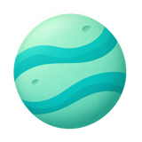

# Dot by QCA

[简体中文](README.md) · English

Dot connects DeepSeek Harness (DSH) on your Mac and Qoder Web on your phone to the same Qoder Cloud Agents (QCA) session.

## What you can do

- **Pick up the same conversation on either device.** Use the DSH panel on Mac or Qoder Web on your phone. Messages, approvals, and results stay in the same session.
- **Delegate work to the cloud or your Mac.** Run cloud tasks in QCA and send authorized local work to DSH. WeChat or Feishu approval reminders are optional.
- **Find tasks and results.** Search DSH conversations, cloud child threads, and Dot receipts in the taskbook. Customize the panel theme and generate a planet avatar.

## Get started

Clone the repository, then run `npm ci --ignore-scripts` and `node server.mjs --mock` from the project directory. Open the [local demo](http://127.0.0.1:4317/).

The [quickstart](docs/user/getting-started.md) covers live QCA setup. Browse the [documentation index](docs/README.md) for the user and developer guides in Chinese.

## Support the project

If Dot helps you, [star the repository](https://github.com/Mappedinfo/dot-by-qca), [report a bug or suggest an improvement](https://github.com/Mappedinfo/dot-by-qca/issues/new), or [contribute code or documentation](docs/development/local-development.md#提交改动).

Dot by QCA is an independent third-party project.
