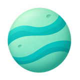

# Dot by QCA

简体中文 · [English](README.en.md)

Dot 把 Mac 上的 DeepSeek Harness（DSH）和手机上的 Qoder 网页接到同一个 Qoder Cloud Agents（QCA）会话。

## 可以做什么

- **在两端接着聊**。Mac 用 DSH 面板，手机用 Qoder 网页。对话、审批和结果回到同一会话。
- **把任务交给云端或 Mac**。QCA 处理云端任务，本机桥接把已获授权的任务交给 DSH。可选微信或飞书审批提醒。
- **找回进度和结果**。任务本支持搜索 DSH 对话、云端子线程和 Dot 回执。可切换面板主题、生成自己的星球头像。

## 开始使用

克隆仓库后，在仓库目录运行 `npm ci --ignore-scripts` 和 `node server.mjs --mock`，再打开[本地演示](http://127.0.0.1:4317/)。

[快速开始](docs/user/getting-started.md)介绍真实 QCA 会话的接入方式。使用和开发说明都在[文档首页](docs/README.md)。

## 支持项目

如果 Dot 对你有用，欢迎[给项目点 Star](https://github.com/Mappedinfo/dot-by-qca)、[提交问题或建议](https://github.com/Mappedinfo/dot-by-qca/issues/new)，也欢迎[贡献代码或文档](docs/development/local-development.md#提交改动)。

Dot by QCA 由第三方独立开发。
